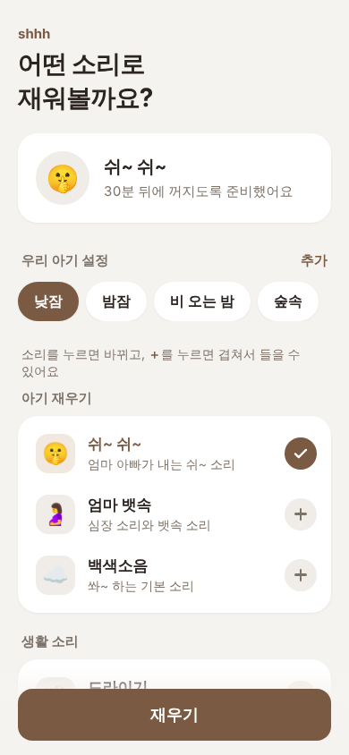
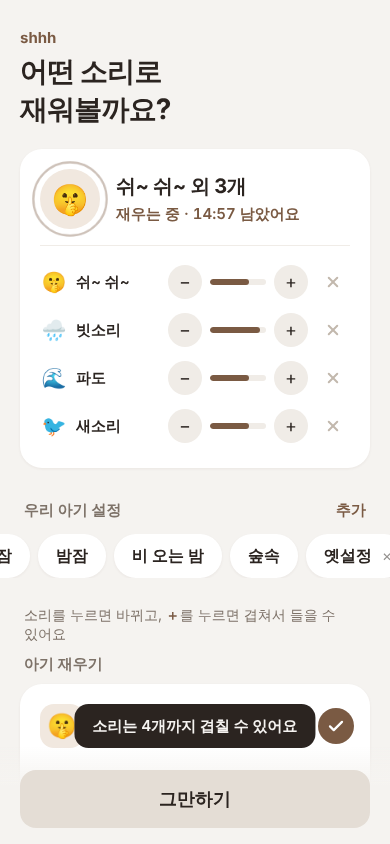
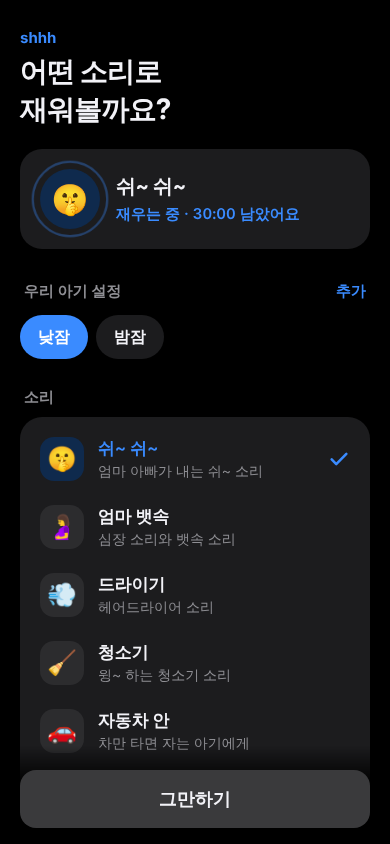

# shhh 아기 재우기

아기를 재우는 엄마, 아빠, 할머니, 할아버지를 위한 소리 앱(PWA)입니다.
음원 파일 없이 모든 소리를 브라우저의 Web Audio API로 실시간 합성합니다.

  

## 기능

- **소리 14가지**
  - 아기 재우기: 쉬~ 쉬~(길게 이어지는 소리), 엄마 뱃속(심장박동 72bpm), 백색소음
  - 생활 소리: 드라이기, 청소기, 자동차 안, 선풍기
  - 자연의 소리: 빗소리, 파도, 시냇물, 바람, 풀벌레, 새소리, 모닥불
- **소리 겹치기:** 소리를 누르면 바뀌고, ＋를 누르면 최대 4개까지 겹쳐 들을 수 있음. 겹친 소리마다 크기 조절·빼기 가능 (리미터로 소리 찢어짐 방지)
- **토스·애플 스타일 화면:** 코코아 갈색 포인트, 흰 카드 리스트, 하단 고정 "재우기" 버튼, 세그먼트 컨트롤. 기기 다크 모드를 따라 자동 전환
- **한 손 조작:** 화면 아래 큰 "재우기 / 그만하기" 버튼, 소리를 누르면 바로 재생
- **어르신도 쉬운 화면:** 큰 글씨, 슬라이더 대신 큰 −/+ 버튼
- **화면 어둡게:** 재생 중 20초간 손대지 않으면 거의 검은 화면으로 바뀜. 재생 중에는 화면 꺼짐을 막아 소리가 끊기지 않게 함
- **자동으로 끄기:** 15분 / 30분 / 1시간 / 끄지 않기. 끝나기 30초 전부터 서서히 줄어듦
- **우리 아기 설정:** 낮잠·밤잠·비 오는 밤·숲속 기본 설정 + 겹친 소리·크기·끄기 시간을 이름 붙여 저장
- **안전 볼륨:** 앱 안의 최대 크기를 낮게 제한하고, 기기 거리·볼륨 안내 표시
- 오프라인 동작, 잠금화면·이어폰 버튼으로 재생/정지

## 실행

빌드 과정이 없는 정적 파일이라 아무 웹 서버로 열면 됩니다.

```sh
python3 -m http.server 8000
# 브라우저에서 http://localhost:8000 열기
```

휴대폰에서 쓰려면 GitHub Pages 등에 올린 뒤 브라우저 메뉴에서 **홈 화면에 추가**를 누르세요.
(서비스 워커는 HTTPS 또는 localhost에서만 동작합니다.)

## 파일 구조

| 파일 | 설명 |
| --- | --- |
| `index.html` | 화면 구성 |
| `style.css` | 스타일 (라이트/다크 모드) |
| `noise.js` | 소리 합성 (각 소리를 끊김 없이 반복되는 버퍼로 생성, 소리별 크기 보정) |
| `app.js` | 재생, 소리 겹치기, 크기, 자동 끄기, 화면 어둡게, 설정 저장 |
| `sw.js` | 오프라인 캐시 |
| `manifest.webmanifest`, `icon.svg` | PWA 설정과 아이콘 |

새 소리를 추가하려면 `noise.js`의 `sounds` 배열에 생성 함수와 묶음(`group`)을 지정해 항목을 하나 추가하면 됩니다.
